  

  

<h2 align="center">👋 Xin chào, mình là Phú!</h2>

  🌱 Đang học tập và phát triển với <strong>Java Spring, React, Node.js/Express.js</strong>  
  💻 Đam mê xây dựng các ứng dụng web hiện đại và hữu ích  
  📫 Kết nối với mình tại:
  <a href="https://www.facebook.com/profile.php?id=61560470347940">Facebook</a>

---

### 💻 Kỹ năng & Công nghệ

---

### 📊 Thống kê GitHub

---

### 🔥 Chuỗi ngày hoạt động

---

> 💬 Cảm ơn bạn đã ghé thăm hồ sơ GitHub của mình! Nếu thấy thú vị, đừng quên ⭐ hoặc theo dõi nhé!

## Donate

